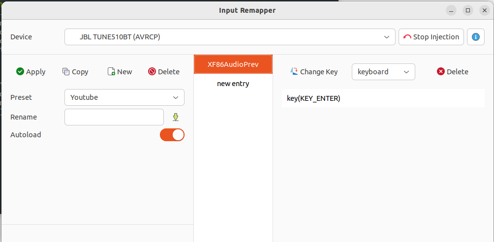

# YouTube Headphone Skip (Linux)
Skip a skippable YouTube ad using a Bluetooth headset button on Linux.

This project combines:
- Tampermonkey, which focuses YouTube's visible Skip button;
- Input Remapper, which maps a headset button to a real `Enter` key event.


## Tested setup
- Linux
- Google Chrome
- Tampermonkey
- Input Remapper
- JBL TUNE510BT (AVRCP)


## How it works
```text
Headset button -> Input Remapper -> key(KEY_ENTER)
 				  |
Tampermonkey -> focuses Skip -----+
				  |
				  v
			    ad is skipped
```

## Installation
### 1. Install the userscript
Install Tampermonkey, create a new userscript, and paste the contents of `youtube-skip-focus.user.js`.
Make sure Tampermonkey is allowed to run userscripts on YouTube in the extension settings.


### 2. Configure Input Remapper
1. Select your headset device.
2. Create a new preset.
3. Click Change Key and press the headset button you want to use.
4. Set the output to: key(KEY_ENTER)
5. Click Apply.
6. Enable Autoload if you want the preset to load automatically when the headset reconnects.

For the JBL TUNE510BT used during testing, the input event was: XF86AudioPrev

## Test
Open a YouTube video and wait for a skippable ad.
When the Skip button becomes available, press the configured headset button.


## Limitations
- This does not block ads.
- It only acts when YouTube provides a skippable ad button.
- YouTube may change its DOM/classes, requiring selector updates.
- Headset input events vary by device and desktop environment.


## Screenshot



## License
MIT


